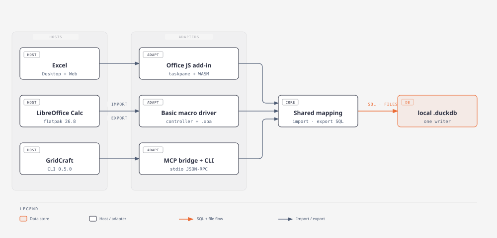
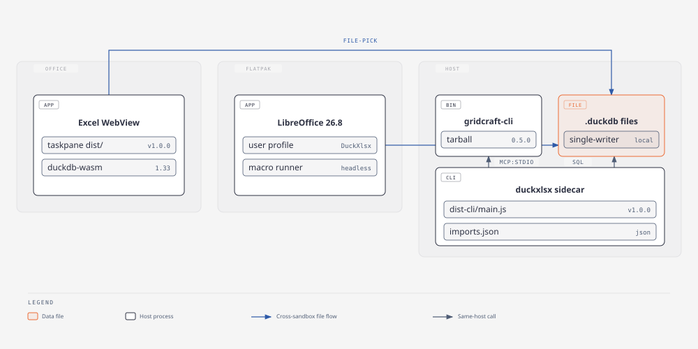

<h1 align="center"> duckxlsx — Spreadsheets with a memory.</h1>

<div align="center">

[](https://nodejs.org/) [](https://www.python.org/) [](#license)

</div>

duckxlsx bridges spreadsheets and DuckDB: import query results into sheets, export sheet work back to tables. No server, no warehouse — a `.duckdb` file on your machine. Works from the Node.js CLI (GridCraft), headless LibreOffice (Calc), or the Excel taskpane add-in.

[](docs/diagrams/architecture.html)

| Adapter | Environment | Entry point |
| --- | --- | --- |
| GridCraft CLI | Node.js CLI | `src/` → [`node dist-cli/main.js`](#quick-start) |
| GridCraft host page | Browser side panel | `host/` + `src/host-server.ts` → [`npm run host`](#gridcraft-host-page-excel-style-side-panel) |
| LibreOffice | Headless Calc | `adapters/lo/` → [`lo_cli.py`](#libreoffice-adapter) |
| Excel | Office JS taskpane (Windows) | `taskpane/` + `manifest/` → [`npm run dev`](#excel-adapter) |

```console
$ node dist-cli/main.js save --name orders --db shop.duckdb --table main.orders --workbook shop.xlsx --range A1
saved orders
$ node dist-cli/main.js run --name orders
orders: 2 rows
```

## Install

Requires Node 22+. From a clone of this repository:

```console
$ npm install
$ npm run build:cli        # compiles TypeScript to dist-cli/ (not committed)
```

Run commands as `node dist-cli/main.js`; the rest of this README abbreviates it as `duckxlsx`. The CLI drives the external `gridcraft-cli` binary — a tarball works, no install needed — so point `GRIDCRAFT_CLI` at it before the first import/export:

```console
$ export GRIDCRAFT_CLI=/path/to/gridcraft-cli
```

Saved imports live in `~/.config/duckxlsx/imports.json` (override with `DUCKXLSX_STORE`).

### DuckDB versions

The CLI and LibreOffice adapter run DuckDB 2.0 (`@duckdb/node-api` and Python `duckdb` 2.0.0). The Excel taskpane still runs DuckDB-WASM 1.5.x, so new database files are created in the 1.5 storage format: both 2.0 clients can still read and write them, and the taskpane can open them. Files created by an external DuckDB 2.0 process use the new storage format and will not open in the taskpane until DuckDB-WASM 2.0 ships.

### LibreOffice adapter

Python 3.11+ (duckdb 2.0 requirement) and headless LibreOffice (flatpak `org.libreoffice.LibreOffice` verified on 26.8.1.1):

```console
$ python3 -m venv adapters/lo/.venv
$ adapters/lo/.venv/bin/pip install duckdb==2.0.0 pytest
$ adapters/lo/.venv/bin/python adapters/lo/setup.py   # deploys the Basic driver
```

### Excel adapter

Windows + Excel; install once with `npm install` as above and see the [Excel adapter](#excel-adapter) section for the cert and sideload setup.

See the [deployment diagram](docs/diagrams/deployment.html) for where each piece runs.

## Quick start

Save a named import, then re-run it whenever the data changes:

```console
$ duckxlsx save --name orders --db shop.duckdb \
    --table main.orders --workbook shop.xlsx --range A1
$ duckxlsx run --name orders
$ duckxlsx export --workbook shop.xlsx --range A1:C3 \
    --table shop_orders --db shop.duckdb          # --overwrite to replace
$ GRIDCRAFT_WEB_DIR=/path/to/gridcraft-web duckxlsx host --port 8766
```

The default `save` pins the column selection; `run` refreshes the bound range from current DuckDB data.

## CLI reference

The headless CLI has six commands (one command per invocation, no prompts — all inputs are flags):

| Command | Purpose | Flags |
| --- | --- | --- |
| `save` | Store a named import | `--name` `--db` `--workbook` `--range` plus `--table SCHEMA.TABLE` (pinned columns) or `--sql SQL` with repeated `--param`; optional `--limit N` to cap preview rows |
| `run` | Re-run a saved import into its bound range | `--name` |
| `remove` | Delete a saved import | `--name` |
| `list` | Print saved imports (name, kind, source, db, limit, range) | — |
| `export` | Write a workbook range into a DuckDB table | `--workbook` `--range` `--table` `--db`; `--no-header` for headerless ranges, `--overwrite` to replace |
| `host` | Serve the GridCraft host page | `--port` (default 8766), `--gridcraft-dir` or env `GRIDCRAFT_WEB_DIR`, `--gridcraft-url` or env `GRIDCRAFT_WEB_URL` |

Exit codes: `0` success, `1` failure, `2` usage error.

## What it handles

| Task | Processing path |
| --- | --- |
| Table import | `import-sql` builds `SELECT`, TSV stages rows, adapter bulk-loads at the bound range |
| Custom SQL import | Parameterized query (`--sql` + `--param`), same TSV path, columns inferred |
| Range export | Adapter reads the range, types previewed from data rows (header excluded), `CREATE` or overwrite into DuckDB |
| Saved imports | JSON store (`save`/`run`/`remove`/`list`), headless re-run, exit 0/1/2 |
| Pivots (Calc) | DataPilot created over the import range, recreate-refresh so appended rows stay inside |

The [GridCraft bulk-path rules](docs/file-swap.md) document the file-exchange constraints.

[](docs/diagrams/deployment.html)

## GridCraft adapter

The TypeScript core (`src/`: import SQL, export mapping, saved store, MCP bridge, headless CLI) drives `gridcraft-cli` (tarball works, no install needed — set `GRIDCRAFT_CLI`):

```console
$ npm test            # vitest; bridge tests need the binary, see note below
$ npm run typecheck   # tsc --noEmit
$ npm run build:cli   # compiles dist-cli/; bin: duckxlsx
```

Bridge tests need `GRIDCRAFT_CLI` pointing at the `gridcraft-cli` binary:

```console
$ GRIDCRAFT_CLI=/path/to/gridcraft-cli npm test
```

Single-writer rule: DuckDB holds the file lock for the process lifetime, so file-level ops go through short-lived children (`scripts/copy-xlsx.mjs`, `scripts/query-file.mjs`). Verify written files via `open_workbook`, not `cat`.

## GridCraft host page (Excel-style side panel)

No add-in API exists in GridCraft, so the panel lives beside it: a local page embedding the GridCraft web build (`?host=parent` iframe) with a duckxlsx sidebar.

```console
$ npm run build:cli
$ GRIDCRAFT_WEB_DIR=/path/to/gridcraft-web npm run host   # http://127.0.0.1:8766
```

Unzip a `gridcraft-web-<version>.zip` release into `GRIDCRAFT_WEB_DIR` (same-origin mount at `/gridcraft/` — GridCraft only answers same-origin parents). Import sends a table as xlsx bytes into the frame via `gridcraft:open`; Save in GridCraft hands bytes back (`gridcraft:save`) for export to a table. See issue #29.

## LibreOffice adapter

The Python controller (`adapters/lo/`: embedded DuckDB + `lo_import.py`, `lo_export.py`, `lo_pilot.py`, `lo_cli.py`) writes TSV + `op.ini` under `~/duckxlsx-io`, invokes headless LibreOffice (`macro:///Standard.DuckXlsx.Run()`), and the Basic driver (`driver/DuckXlsx.xba`) bulk-loads via `setDataArray` / reads via `getDataArray`, reporting back in `result.ini`:

```console
$ adapters/lo/.venv/bin/python -m pytest adapters/lo/tests/ -q
```

Run dirs must live under `$HOME` (invisible in the flatpak sandbox); a stray `soffice.bin` swallows macro runs, so the runner fails fast with a kill hint. No UNO socket, no in-LO Python — both are broken in common installs.

## Excel adapter

The Office JS taskpane (`taskpane/` + `src/catalog.ts` + `src/wasm-engine.ts`, manifest in `manifest/`) talks to a local `.duckdb` through embedded DuckDB-WASM: connect via file picker (or the `<input type=file>` fallback), browse schemas/tables/columns, preview the live selection with inferred column names and types, override them, and export to a table — `CREATE`, or `CREATE OR REPLACE` behind an inline overwrite prompt. Import/pivots/refresh follow in #10+.

```console
# once: mint a localhost cert Excel/WebView2 will trust
$ mkcert -install
$ mkcert -key-file certs/localhost-key.pem -cert-file certs/localhost.pem localhost 127.0.0.1

$ npm run dev     # vite dev server on https://localhost:3000 (plain http when certs/ is absent)
$ npm run build   # dist/ taskpane bundle, for serving from any static https host
```

The manifest's `SourceLocation` is `https://localhost:3000`; on Windows, WebView2 additionally needs the localhost loopback exemption once (admin PowerShell):

```powershell
CheckNetIsolation LoopbackExempt -a -n="microsoft.win32webviewhost_cw5n1h2txyewy"
```

Sideload (developer registry, no UI dialog — verify the manifest path):

```powershell
reg add "HKCU\Software\Microsoft\Office\16.0\WEF\Developer" /v 3F6A7C2E-1D4B-4A5E-9C8F-0D0C4B1A2E01 /t REG_SZ /d "<repo>\manifest\manifest.xml" /f
```

then Home ▸ Add-ins ▸ Developer Add-ins ▸ duckxlsx. Connect + catalog + live-selection export with a column-mapping override + the overwrite prompt were verified inside Excel (Win32 WebView2, CDP-driven pane); `src/pane-host-constraints.test.ts` guards the host-only constraints a browser harness cannot see.

## Documentation

Start with the diagrams, then follow the guide for your task:

- [Architecture](docs/diagrams/architecture.html) (system overview) and [deployment](docs/diagrams/deployment.html) (where each piece runs)
- [GridCraft bulk-path rules](docs/file-swap.md) and [agent docs](docs/agents/) (issue tracker, triage labels, domain rules)
- [Environment rules](docs/environment-rules.md) — empirical hard-won constraints (DuckDB finalization, `.xba` escaping, WebView2 dialogs, WAL handoff); do not work around
- [GLOSSARY.md](GLOSSARY.md) for the shared vocabulary

## Development

```console
$ npm install
$ npm test && npm run typecheck
$ adapters/lo/.venv/bin/python -m pytest adapters/lo/tests/ -q
```

Work tracks GitHub Issues (`y-ashish-y/duckxlsx`): specs carry `ready-for-agent`, tickets declare `Blocked by`. Conventions: TDD at the agreed seams, two-axis code review before merge, one tracer-bullet ticket per branch.

## License

[MIT](LICENSE). See `license` in [package.json](package.json).
